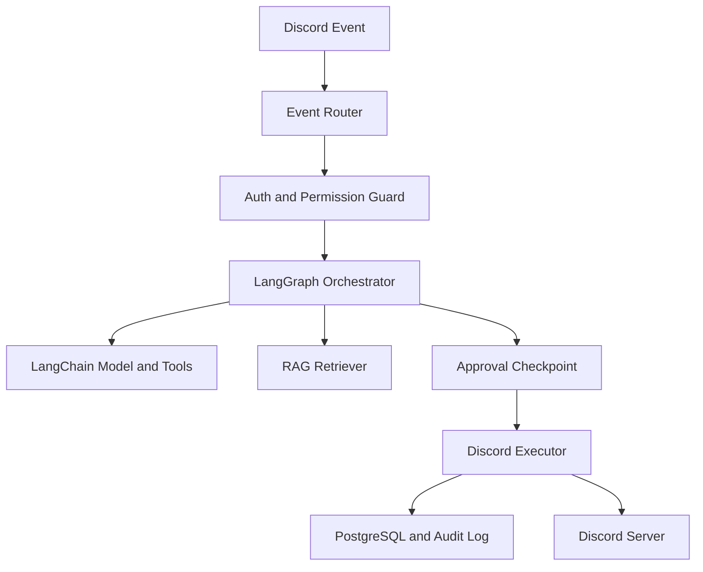
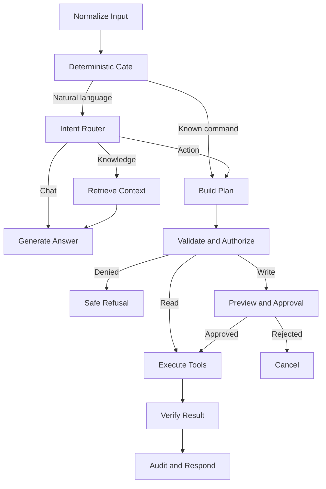
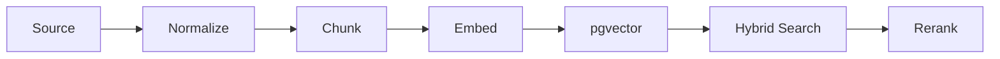

# Discord AI Server Manager — Implementation Plan

## 1. Tầm nhìn sản phẩm

Xây dựng một Discord Bot bằng TypeScript có khả năng hiểu yêu cầu ngôn ngữ tự nhiên, truy xuất dữ liệu riêng của từng server và gọi đúng tool để quản lý server hoặc hỗ trợ cộng đồng. Bot có thể tạo, sửa, xóa channel/category; tạo embed; reply hoặc gửi tin nhắn; trả lời FAQ; lên lịch nội dung và hỗ trợ moderator.

AI chỉ được **đề xuất tool call**. Backend mới là thành phần kiểm tra quyền, validate arguments, yêu cầu xác nhận và thực thi Discord API. Mọi thao tác thay đổi server đều phải có audit log.

## 2. Mục tiêu và tiêu chí thành công

| Mục tiêu | Tiêu chí đo lường |
| --- | --- |
| Hiểu đúng yêu cầu của người dùng | ≥ 90% intent/tool selection trên bộ eval nội bộ |
| Không thực thi vượt quyền | 100% write tool đi qua permission guard |
| Không xóa/sửa nhầm tài nguyên | 100% destructive action có preview và xác nhận |
| Trả lời đúng dữ liệu server | Có citation nội bộ; từ chối khi context không đủ |
| Tối ưu chi phí AI | Không gọi LLM cho permission, validation, scheduling và Discord execution |
| Có khả năng khôi phục | Workflow có checkpoint, idempotency key và compensation action |
| Vận hành ổn định | Có retry có giới hạn, rate-limit handling, metrics và alert |

## 3. Phạm vi chức năng

### 3.1 Quản lý server

- Đọc cấu trúc server, channel, category, role và permission.
- Tạo, đổi tên, di chuyển và cấu hình channel/category.
- Chỉnh topic, slowmode và permission overwrite.
- Xóa channel/category sau khi xác nhận.
- Lập kế hoạch nhiều bước từ một câu lệnh tự nhiên.

### 3.2 Tin nhắn và nội dung

- Gửi, reply, sửa hoặc xóa tin nhắn do bot tạo.
- Tạo embed, poll, announcement và event post.
- Tạo bản nháp theo giọng văn của server.
- Lên lịch và quản lý nội dung định kỳ.

### 3.3 Knowledge Assistant

- Trả lời khi được mention, reply hoặc gọi slash command.
- Tìm FAQ, chính sách, sản phẩm, sự kiện và hướng dẫn bằng RAG.
- Filter dữ liệu theo guild, visibility và role.
- Chuyển câu hỏi không chắc chắn cho moderator.

### 3.4 Community Automation

- Welcome message, FAQ suggestion, reminder và weekly recap.
- Gợi ý câu hỏi thảo luận hoặc nội dung cho moderator duyệt.
- Không tạo tương tác giả, không spam và không dùng user token/self-bot.

## 4. Kiến trúc tổng thể



### Vai trò từng tầng

| Tầng | Trách nhiệm |
| --- | --- |
| Discord Adapter | Nhận interaction/event, gửi response và gọi Discord API |
| Event Router | Phân loại slash command, mention, reply, button và modal |
| Permission Guard | Xác minh guild, user, role, channel và quyền thực tế của bot |
| LangGraph | Quản lý workflow, state, branch, checkpoint, retry và approval |
| LangChain | Model adapter, prompt, structured output, tool binding và retriever |
| Policy Engine | Phân loại rủi ro, quota, cooldown, allowlist và confirmation policy |
| Tool Registry | Khai báo schema, authorize, preview, execute và compensate |
| RAG Service | Ingest, embedding, hybrid retrieval, rerank và citation |
| Persistence | Config, knowledge, workflow state, job, audit và feedback |

## 5. Stack công nghệ

| Thành phần | Lựa chọn |
| --- | --- |
| Runtime | Node.js + TypeScript strict mode |
| Discord | discord.js |
| AI orchestration | LangChain.js + LangGraph.js |
| Model API | Provider hỗ trợ tool/function calling và structured output |
| Validation | Zod |
| Database | PostgreSQL |
| Vector search | pgvector |
| Full-text search | PostgreSQL `tsvector` |
| ORM | Drizzle ORM |
| Checkpoint | PostgreSQL LangGraph checkpointer |
| Queue/scheduler | BullMQ + Redis |
| Logging | Pino |
| Monitoring | OpenTelemetry + Sentry |
| Testing | Vitest + test Discord guild |
| Deployment | Docker Compose; sau đó có thể chuyển Kubernetes |

## 6. Thiết kế LangGraph

### 6.1 Agent State

```ts
type AgentState = {
  requestId: string;
  guildId: string;
  channelId: string;
  userId: string;
  memberRoleIds: string[];
  input: string;
  intent?: "chat" | "knowledge" | "action" | "schedule";
  retrievedContext?: RetrievedChunk[];
  proposedCalls?: ProposedToolCall[];
  riskLevel?: "read" | "write" | "destructive";
  approval?: "not_required" | "pending" | "approved" | "rejected";
  toolResults?: ToolResult[];
  finalResponse?: string;
  error?: AgentError;
};
```

`guildId`, `userId`, `channelId` và role phải lấy từ Discord event; model không được phép tự tạo hoặc thay đổi các giá trị này.

### 6.2 Graph chính



### 6.3 Nodes

| Node | Có gọi LLM? | Chức năng |
| --- | --- | --- |
| `normalizeInput` | Không | Chuẩn hóa mention, reply context và command |
| `deterministicGate` | Không | Route slash command/tool rõ ràng mà không cần AI |
| `intentRouter` | Có, model nhỏ | Phân loại chat, knowledge, action hoặc schedule |
| `retrieveKnowledge` | Chỉ embedding/rerank | Hybrid search theo guild và role |
| `planTools` | Có | Sinh danh sách tool call có schema chặt |
| `validatePlan` | Không | Zod, quota, resource resolution và permission |
| `classifyRisk` | Không | Risk lấy từ metadata của tool, không hỏi model |
| `requestApproval` | Không | Lưu checkpoint; gửi preview/buttons |
| `executeTools` | Không | Gọi Discord API theo dependency order |
| `verifyResults` | Không mặc định | Kiểm tra Discord response và invariant |
| `compensate` | Không | Rollback các bước có compensation action |
| `composeResponse` | Có tùy trường hợp | Viết phản hồi tự nhiên từ structured results |
| `audit` | Không | Ghi request, approval, tool input/output và lỗi |

### 6.4 Human-in-the-loop

Với write/destructive action, graph dừng bằng checkpoint sau khi tạo preview. Button `Confirm` hoặc `Cancel` tiếp tục đúng workflow bằng `requestId/threadId`. Approval phải có TTL, chỉ người có quyền mới được xác nhận và plan phải bị khóa hash để tránh thay arguments sau khi duyệt.

## 7. Cách tối ưu số lần gọi API/LLM

LangChain/LangGraph không tự động làm API rẻ hơn. Hiệu quả đến từ cách thiết kế graph:

| Kỹ thuật | Cách triển khai |
| --- | --- |
| Deterministic routing | Slash command và button đi thẳng vào code, không gọi model |
| Model routing | Model nhỏ cho intent; model mạnh chỉ dùng cho plan phức tạp |
| Tool subset | Chỉ bind nhóm tool phù hợp intent thay vì gửi toàn bộ tool schema |
| Context filtering | Chỉ gửi guild config và channel/role liên quan |
| Hybrid retrieval | Lọc metadata và full-text trước khi vector/rerank |
| Semantic cache | Cache FAQ tương tự theo guild, knowledge version và role scope |
| Prompt caching | Giữ system/tool prefix ổn định nếu provider hỗ trợ |
| Structured output | Zod/JSON Schema để giảm retry vì sai format |
| Single planning call | Một lần tạo toàn bộ execution plan, code tự sắp dependency |
| No LLM execution loop | Tool result rõ ràng được format bằng template, không gửi lại model |
| Conditional final call | Chỉ dùng model viết final response khi kết quả phức tạp |
| Checkpoint resume | Sau approval tiếp tục graph, không chạy lại planning và retrieval |
| Bounded retries | Chỉ retry lỗi transient; không tự loop vô hạn |
| Idempotency | Không gọi lại Discord API khi request đã thực thi thành công |
| Conversation summary | Tóm tắt theo ngưỡng thay vì gửi toàn bộ lịch sử |

Mục tiêu cho một request phổ biến:

- FAQ cache hit: 0 lần gọi generation model.
- FAQ cache miss: 1 embedding + 1 generation call.
- Action đơn giản từ slash command: 0 generation call.
- Action tự nhiên đơn giản: 1 planning call.
- Workflow có approval: vẫn 1 planning call; resume từ checkpoint.
- Action phức tạp cần phản hồi tự nhiên: tối đa 2 generation calls.

## 8. Tool Registry

```ts
interface DiscordTool<I, O> {
  name: string;
  description: string;
  risk: "read" | "write" | "destructive";
  schema: z.ZodType<I>;
  requiredBotPermissions: bigint[];
  authorize(ctx: ToolContext, input: I): Promise<AuthResult>;
  preview(ctx: ToolContext, input: I): Promise<ToolPreview>;
  execute(ctx: ToolContext, input: I): Promise<O>;
  compensate?(ctx: ToolContext, result: O): Promise<void>;
}
```

### Tool catalog MVP

| Nhóm | Tools |
| --- | --- |
| Read | `list_guild_structure`, `get_channel`, `get_role`, `search_knowledge` |
| Category | `create_category`, `update_category`, `delete_category` |
| Channel | `create_channel`, `update_channel`, `move_channel`, `delete_channel` |
| Permission | `set_channel_permissions`, `sync_category_permissions` |
| Message | `send_message`, `reply_message`, `send_embed`, `edit_bot_message`, `delete_bot_message` |
| Content | `draft_announcement`, `create_poll`, `schedule_message` |
| Support | `create_ticket`, `escalate_to_moderator` |

Không xây tool chung kiểu `execute_discord_action`. Tool riêng giúp schema nhỏ, permission rõ và audit dễ kiểm tra.

## 9. Policy và mức độ rủi ro

| Mức | Ví dụ | Chính sách |
| --- | --- | --- |
| Read | Đọc cấu trúc, tìm FAQ | Chạy ngay nếu user được phép dùng bot |
| Low write | Reply, gửi draft vào sandbox channel | Có thể chạy ngay theo guild setting |
| Write | Tạo/sửa channel, gửi announcement | Preview + một lần xác nhận |
| Destructive | Xóa channel/category, sửa permission rộng | Preview chi tiết + xác nhận mạnh + TTL |
| Prohibited | Spam, engagement giả, self-bot | Từ chối |

Các giới hạn mặc định:

- Tối đa 10 tool calls trong một request.
- Tối đa 5 tài nguyên Discord được tạo trong một transaction plan.
- `@everyone`/`@here` bị chặn nếu chưa có quyền và xác nhận riêng.
- Xóa category phải hiển thị toàn bộ channel con.
- Bot không được tự cấp quyền cao hơn quyền người yêu cầu.

## 10. RAG và vector embedding

### Dữ liệu phù hợp

- FAQ, luật server, chính sách hỗ trợ.
- Sản phẩm, giá, hướng dẫn mua hàng.
- Sự kiện, giải đấu và announcement cũ.
- Brand voice và nội dung đã được moderator duyệt.

Permission, channel IDs, workflow state, job và audit phải lưu bằng bảng quan hệ, không lưu như vector knowledge.

### Ingestion pipeline



Metadata tối thiểu: `guildId`, `documentId`, `sourceType`, `visibility`, `allowedRoleIds`, `version`, `checksum`, `updatedAt`.

Retrieval phải filter quyền trước khi đưa context vào model. Mỗi câu trả lời knowledge phải lưu các chunk IDs đã sử dụng. Nếu score thấp hoặc các nguồn mâu thuẫn, bot không được đoán mà phải hỏi lại hoặc escalate.

## 11. Database

| Nhóm | Bảng chính |
| --- | --- |
| Server config | `guilds`, `guild_settings`, `guild_ai_channels`, `guild_allowed_roles` |
| Knowledge | `knowledge_documents`, `knowledge_chunks`, `knowledge_embeddings` |
| Conversation | `conversation_threads`, `conversation_messages`, `conversation_summaries` |
| Workflow | `graph_checkpoints`, `approval_requests`, `tool_executions` |
| Automation | `scheduled_jobs`, `content_templates` |
| Governance | `audit_logs`, `feedback`, `moderation_escalations` |

`tool_executions` cần lưu: request ID, guild, requester, tool name, normalized arguments, risk, status, approver, idempotency key, Discord result, error và timestamps.

## 12. Cấu trúc source code

```text
src/
├── app.ts
├── config/
├── discord/
│   ├── client.ts
│   ├── commands/
│   ├── events/
│   ├── components/
│   └── permissions/
├── agent/
│   ├── graph.ts
│   ├── state.ts
│   ├── routing.ts
│   ├── prompts/
│   ├── nodes/
│   └── checkpoints/
├── tools/
│   ├── registry.ts
│   ├── channels/
│   ├── categories/
│   ├── permissions/
│   └── messages/
├── knowledge/
│   ├── ingest.ts
│   ├── chunk.ts
│   ├── retrieve.ts
│   └── rerank.ts
├── policies/
├── database/
├── jobs/
├── observability/
└── shared/
```

## 13. Roadmap triển khai

| Phase | Phạm vi | Công việc | Definition of Done |
| --- | --- | --- | --- |
| 0. Discovery | Chốt nghiệp vụ | Use cases, role matrix, test guild, risk policy, AI budget | Có backlog và acceptance criteria |
| 1. Foundation | Bot TypeScript | Discord app, slash commands, config, PostgreSQL, Docker, logging | Bot online, command và permission hoạt động |
| 2. Tool Core | Công cụ an toàn | Tool Registry, Zod, read tools, message/embed tools, audit | Tool chạy độc lập và có unit test |
| 3. LangGraph | AI orchestration | State, router, planner, conditional edges, retry, idempotency | Natural-language request tạo đúng plan |
| 4. Approval | Human-in-the-loop | Preview, buttons, checkpoint, TTL, resume, cancellation | Write action không thể bỏ qua approval |
| 5. Server Tools | Quản lý server | Channel/category/permission tools, dependency resolution, compensation | Tạo/sửa/xóa đúng trên test guild |
| 6. RAG | Knowledge assistant | Ingest, pgvector, hybrid retrieval, role filter, citation, feedback | FAQ eval đạt target và không lộ staff data |
| 7. Automation | Nuôi server an toàn | Scheduler, content template, recap, reminder, moderator queue | Nội dung được duyệt và không spam |
| 8. Hardening | Production | Rate limit, load test, prompt injection test, monitoring, backup, CI/CD | Đạt security checklist và SLO |

## 14. Test strategy

### Unit tests

- Zod schema của từng tool.
- Permission và risk policy.
- Graph routing và conditional edges.
- Resource resolver, idempotency và compensation.

### Integration tests

- Discord API trên test guild.
- PostgreSQL checkpoint/resume.
- RAG ingestion và role-filtered retrieval.
- Approval từ đúng/sai user và request hết hạn.

### AI evals

- Intent classification.
- Tool selection.
- Argument correctness.
- Không gọi destructive tool khi yêu cầu mơ hồ.
- Prompt injection trong message và knowledge document.
- Không trả dữ liệu staff cho member.

### Failure tests

- Discord rate limit và timeout.
- Model timeout hoặc invalid output.
- Bot thiếu permission.
- Channel bị xóa giữa plan và execute.
- Workflow restart sau khi đã approval.

## 15. Observability và chi phí

Theo dõi theo guild và workflow:

- Số generation calls, embedding calls và tokens.
- Cache hit rate và retrieval latency.
- Tool success/failure rate.
- Approval rate và expired approvals.
- Discord rate limits.
- Chi phí AI trên mỗi request và mỗi guild.
- Số lần retry, rollback và escalation.

Đặt budget guard theo ngày/tháng. Khi vượt budget, bot chuyển sang model nhỏ, tắt chức năng không thiết yếu hoặc chỉ cho phép slash command/read-only thay vì tiếp tục gọi model không giới hạn.

## 16. MVP đề xuất

MVP đầu tiên gồm:

1. `/ai` và mention bot trong channel được phép.
2. LangGraph router, planner, validation và approval checkpoint.
3. `list_guild_structure`, `create/update/delete_channel`, `create/update/delete_category`.
4. `send_message`, `reply_message`, `send_embed`.
5. PostgreSQL, audit log và pgvector RAG.
6. Role allowlist, rate limit và confirmation buttons.
7. Docker Compose và CI test.

Chưa làm trong MVP: multi-agent, dashboard web, voice, fine-tuning, auto-moderation nâng cao và Kubernetes.

## 17. Thứ tự implementation thực tế

1. Xây Discord adapter và permission guard trước khi tích hợp AI.
2. Viết tool như các service độc lập và test trực tiếp.
3. Tạo LangGraph bằng tool giả để test routing/checkpoint.
4. Gắn tool thật sau khi policy và approval hoạt động.
5. Thêm RAG sau khi core action workflow ổn định.
6. Chỉ bật automation sau khi có audit, quota và moderator approval.

## 18. Kết quả cuối cùng

Hệ thống hoàn chỉnh là một Discord AI Bot có thể hiểu ngôn ngữ tự nhiên nhưng vẫn hoạt động theo nguyên tắc least privilege. LangChain chuẩn hóa model/tool/retrieval; LangGraph quản lý state, branch, checkpoint và human approval. Discord API chỉ được gọi bởi executor đã qua validation và policy. Thiết kế này vừa mở rộng tốt, vừa kiểm soát chi phí và giảm đáng kể các lần gọi AI không cần thiết.
